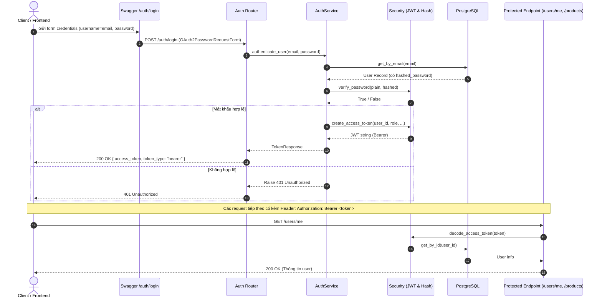

# Kế hoạch chi tiết triển khai Authentication (OAuth2 + JWT)

Tài liệu này vạch ra kiến trúc và các bước cụ thể để tích hợp hệ thống xác thực **OAuth2 với JWT (JSON Web Token)** theo chuẩn của FastAPI, đảm bảo tính bảo mật, dễ mở rộng và tương thích 100% với nút **Authorize** trong Swagger UI.

---

## 🎯 Mục tiêu
1. Cung cấp API đăng nhập `/auth/login` nhận credentials (`email` + `password`) và trả về `access_token` JWT.
2. Cung cấp API `/auth/me` lấy thông tin tài khoản đang đăng nhập.
3. Tạo dependency `get_current_user` để bảo vệ các endpoint cần đăng nhập.
4. Triển khai phân quyền theo vai trò (**RBAC - Role-Based Access Control**): Giới hạn quyền giữa `Admin`, `Customer`, `Guest`.
5. Tích hợp trực tiếp vào Swagger UI để test token tiện lợi.

---

## 🏗️ Luồng hoạt động (Architecture Flow)



---

## 📦 Các thư viện cần bổ sung

| Thư viện | Mục đích |
|---|---|
| `pyjwt` | Tạo, mã hóa và giải mã JSON Web Token (nhẹ, bảo mật, chuẩn PEP) |
| `python-multipart` | Bắt buộc để FastAPI parse được `OAuth2PasswordRequestForm` (form-data) |

---

## 🗺️ Cấu trúc thư mục sau khi hoàn thành

```text
src/
├── config/
│   ├── database.py
│   └── settings.py          # Biến môi trường: SECRET_KEY, ALGORITHM, ACCESS_TOKEN_EXPIRE_MINUTES
├── dependencies/            # Tầng Dependencies chuyên dụng
│   ├── auth.py              # get_current_user, require_role(roles)
├── schemas/
│   ├── user.py
│   └── auth.py              # TokenResponse, TokenPayload, LoginRequest
├── services/
│   ├── user_service.py
│   └── auth_service.py      # Xử lý xác thực tài khoản & cấp token
├── routers/
│   ├── user.py
│   └── auth.py              # POST /auth/login, GET /auth/me
├── security/
│   ├── security.py          # Hash / verify password (đã có)
│   └── jwt.py               # create_access_token, decode_access_token
└── main.py                  # Đăng ký auth router
```

---

## 📋 Các giai đoạn triển khai chi tiết

### Giai đoạn 1: Cài đặt thư viện & Cấu hình môi trường
- [ ] Cài đặt `pyjwt` và `python-multipart`:
  ```powershell
  .\.venv\Scripts\pip.exe install pyjwt python-multipart
  ```
- [ ] Cập nhật file `.env`:
  ```env
  JWT_SECRET_KEY=your_super_secret_key_random_hex_string
  JWT_ALGORITHM=HS256
  ACCESS_TOKEN_EXPIRE_MINUTES=60
  ```
- [ ] Tạo file `src/config/settings.py` đọc cấu hình JWT từ `.env`.

---

### Giai đoạn 2: Tầng Security (JWT Helper)
- [ ] Tạo file `src/security/jwt.py`:
  - `create_access_token(subject: str, role: str, expires_delta: timedelta = None) -> str`:
    - Tạo payload gồm: `sub` (user_id hoặc email), `role`, `exp` (thời gian hết hạn), `iat` (thời gian phát hành).
    - Mã hóa payload bằng `SECRET_KEY` và thuật toán `HS256`.
  - `decode_access_token(token: str) -> dict`:
    - Giải mã token, xử lý ngoại lệ: `ExpiredSignatureError` (token hết hạn) và `InvalidTokenError` (token không hợp lệ).

---

### Giai đoạn 3: Schemas & Service Xác thực (Auth Layer)
- [ ] Tạo file `src/schemas/auth.py`:
  - `TokenResponse`:
    ```python
    class TokenResponse(BaseModel):
        access_token: str
        token_type: str = "bearer"
    ```
  - `TokenData`: Chứa thông tin payload giải mã được (`user_id: int`, `role: str`).
- [ ] Tạo file `src/services/auth_service.py`:
  - `authenticate_user(email, password) -> User`: Tìm user bằng `get_by_email`, so sánh mật khẩu qua `verify_password`.
  - `create_token_for_user(user: User) -> TokenResponse`: Sinh access token mang thông tin user.

---

### Giai đoạn 4: Dependency Injector & Phân quyền (RBAC)
- [ ] Tạo file `src/dependencies/auth.py`:
  - Khai báo chuẩn OAuth2:
    ```python
    oauth2_scheme = OAuth2PasswordBearer(tokenUrl="/auth/login")
    ```
  - Viết dependency `get_current_user`:
    - Nhận token từ header `Authorization: Bearer <token>`.
    - Gọi `decode_access_token`.
    - Lấy user từ DB theo `user_id`. Nếu không thấy hoặc token lỗi ➡️ ném `HTTPException(401)`.
  - Viết Dependency Factory `require_roles(allowed_roles: list[Role])`:
    - Kiểm tra `current_user.role` có nằm trong danh sách cho phép không. Nếu không ➡️ ném `HTTPException(403 Forbidden)`.

---

### Giai đoạn 5: Router Authentication (`/auth`)
- [ ] Tạo file `src/routers/auth.py`:
  - `POST /auth/login`:
    - Sử dụng `Depends(OAuth2PasswordRequestForm)` để tương thích nút **Authorize** của Swagger UI.
    - Trả về `TokenResponse`.
  - `GET /auth/me`:
    - Yêu cầu `current_user: User = Depends(get_current_user)`.
    - Trả về `UserResponse`.
- [ ] Đăng ký `auth_router` vào `src/main.py`.

---

### Giai đoạn 6: Bảo vệ các API hiện có
- [ ] Áp dụng bảo vệ vào `src/routers/user.py`:
  - `GET /users/`: Chỉ cho phép `Role.ADMIN` truy cập (`Depends(require_roles([Role.ADMIN]))`).
  - `GET /users/{id}`: Cho phép `Admin` hoặc chính user đó xem.
  - `DELETE /users/{id}`: Chỉ cho phép `Role.ADMIN`.

---

### Giai đoạn 7: Kiểm thử toàn diện & Swagger UI
- [ ] Mở `/docs`, bấm nút **Authorize** ở góc phải màn hình, đăng nhập bằng email + password.
- [ ] Gọi thử các API được bảo vệ để kiểm tra token và phân quyền.
- [ ] Viết kịch bản test:
  1. Login sai mật khẩu ➡️ `401 Unauthorized`.
  2. Login đúng ➡️ nhận token `200 OK`.
  3. Dùng token gọi `/auth/me` ➡️ lấy đúng thông tin.
  4. User bình thường gọi API chỉ dành cho Admin ➡️ `403 Forbidden`.
